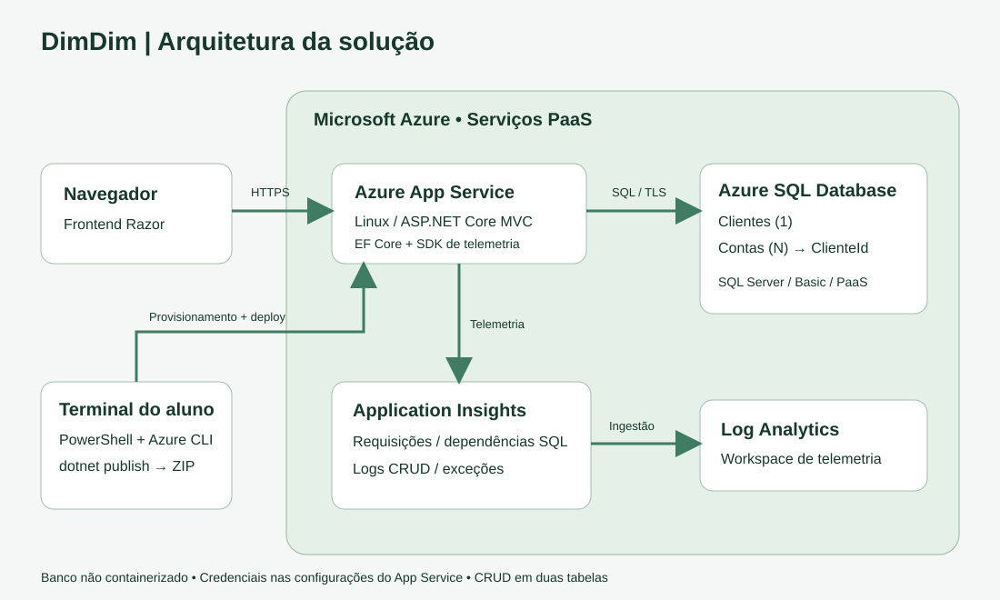

# DimDim — Aplicação Web e Banco em Nuvem

Mateus Teni Pierro — RM 555125. Grupo usado no pacote: **MateusPierro** (ajuste caso tenha outros integrantes).

Aplicação acadêmica nova em ASP.NET Core MVC / .NET 8 com frontend Razor, Azure App Service Linux, Azure SQL Database PaaS e Application Insights. Não é API e não é projeto de Sprint 3. Clientes têm várias contas; cada conta pertence a um cliente. Os dois cadastros oferecem criar, listar/detalhar, editar e excluir. O dashboard apresenta totais persistidos. CPF e número de conta são únicos; excluir um cliente com contas é bloqueado.

## Arquitetura



Os componentes dentro da Azure são serviços PaaS. O navegador acessa o App Service via HTTPS; EF Core usa SQL Server por conexão TLS; o SDK do Application Insights envia telemetria de requisições, dependências SQL, logs e exceções. O CLI provisiona os recursos e envia um ZIP produzido por `dotnet publish`. Os segredos são solicitados durante a execução e gravados nas configurações do App Service, fora do repositório.

## O que está pronto e o que precisa executar

Incluídos: código completo, frontend, scripts Azure CLI/PowerShell, DDL, consultas de evidência, consultas KQL, tutorial de implantação, roteiro de vídeo e gerador do PDF final.

Este pacote **não foi compilado nem implantado pelo autor neste ambiente**, que não dispõe de SDK .NET nem acesso à sua assinatura Azure. Não contém evidências inventadas. `00-validar.ps1` faz restore/build e `01-provisionar.ps1` executa essa validação antes de criar recursos. A validação real da nuvem e dos CRUDs deve seguir este tutorial.

Não entreguem somente localhost. Vídeo, GitHub e implantação Azure ainda precisam ser executados. O PDF em `entrega/` é um modelo com links pendentes: substitua-o usando o gerador depois de obter os links reais.

## 1. Preparar o Windows

Instale:

- SDK .NET **8**: https://dotnet.microsoft.com/download/dotnet/8.0
- Azure CLI: https://learn.microsoft.com/cli/azure/install-azure-cli-windows
- Python 3 (apenas para gerar o PDF): https://www.python.org/downloads/

Abra PowerShell na pasta extraída `DimDimWebApp`, aquela que contém este README. Não execute os scripts no CMD. A política abaixo vale somente para este terminal:

```powershell
Set-ExecutionPolicy -Scope Process -ExecutionPolicy Bypass
Get-Location
dotnet --list-sdks
az version
az login
az account list --query "[].{Nome:name,ID:id,Padrao:isDefault}" -o table
az account set --subscription "COLE_O_ID_DA_SUA_ASSINATURA"
./scripts/00-validar.ps1
```

A compilação precisa concluir sem erros. O NuGet precisa estar acessível. SDKs mais recentes podem compilar `net8.0`, mas instale o SDK 8 se os pacotes de destino estiverem ausentes.

## 2. Criar os recursos pelo Azure CLI

O script utiliza **App Service B1**, **Azure SQL Basic**, workspace Log Analytics e Application Insights: consomem créditos ou geram cobrança. Confira créditos, orçamento e disponibilidade da assinatura antes de executar.

Escolha um prefixo exclusivo, em letras minúsculas, sem espaços. Exemplo: `dimdim-555125-0610a`. Não use o mesmo exemplo se o nome global já estiver ocupado.

```powershell
./scripts/01-provisionar.ps1 -Prefixo "dimdim-555125-0610a" -Regiao "brazilsouth"
```

O script pede usuário e senha SQL. Guarde-os em local privado; não grave senha no vídeo nem no README. A senha não aparece na tela. Escolha pelo menos 12 caracteres, com maiúscula, minúscula, número e símbolo, sem espaços, aspas ou ponto e vírgula. Não use `admin` como usuário. O arquivo `.azure-state.json` guarda apenas nomes e URL, e está ignorado no Git.

Este script não usa Docker, PostgreSQL nem banco local. Cria Azure SQL Database e libera no firewall os IPs de saída possíveis do App Service. Não há regra de liberação de todos os serviços Azure.

### Região ou política da assinatura

Se aparecer `RequestDisallowedByAzure`, use uma região autorizada na SUA assinatura. Se o App Service, SQL ou monitoramento não estiver disponível na mesma região, você pode separar:

```powershell
./scripts/01-provisionar.ps1 -Prefixo "OUTRO-PREFIXO-UNICO" -Regiao "brazilsouth" -RegiaoSql "francecentral" -RegiaoMonitor "francecentral"
```

Os nomes acima são exemplos, não garantia de disponibilidade. Consulte as regiões permitidas no portal / política `Allowed locations`. Confira runtimes e regiões do plano:

```powershell
az webapp list-runtimes --os linux -o table
az appservice list-locations --sku B1 --linux-workers-enabled -o table
az policy assignment list --query "[].{Nome:displayName,Parametros:parameters}" -o json
```

Para erro de quota B1, verifique uso/quotas da assinatura no portal. Se uma execução falhar parcialmente, pode haver recursos cobrando no grupo `<prefixo>-rg`. Consulte-os no portal antes de repetir. O script interrompe no primeiro erro e não apaga recursos automaticamente. Você pode repetir o mesmo comando para completar a criação enquanto não existir `.azure-state.json`; os comandos de criação são de atualização/criação. Para senha incorreta em servidor já criado, ajuste-a no portal ou use um novo grupo.

## 3. Publicar de forma automatizada

```powershell
./scripts/02-deploy.ps1
./scripts/04-status.ps1
```

O script compila/publica, compacta **o conteúdo** de `artifacts/publish` e usa `az webapp deploy --type zip`. Essa é a opção exigida **Azure CLI + az webapp deploy**, portanto GitHub Actions não é necessário. Abra a URL exibida, que também fica em `.azure-state.json`.

O primeiro início cria as tabelas e índices por `EnsureCreatedAsync` quando o banco está vazio. O DDL equivalente está em `scripts/ddl.sql`. Alternativamente execute esse DDL no banco `dimdimdb` antes do primeiro deploy; o EF detecta as tabelas existentes. Não misture esse projeto com um banco de outro projeto: `EnsureCreated` não modifica tabelas existentes nem realiza migrações.

Após mudar código, execute novamente somente `02-deploy.ps1`. Dados existentes são preservados. Se mudar os IPs de saída do plano, atualize as regras do firewall SQL.

## 4. Consultar o banco no portal

1. Azure Portal → SQL databases → `dimdimdb` do grupo deste projeto.
2. Abra **Query editor / Editor de consultas (preview)** e autentique com o usuário/senha SQL usados no provisionamento. O nome do servidor é `<prefixo>-sql.database.windows.net`.
3. Caso o portal bloqueie seu IP, use a opção de permitir o endereço detectado. Ou execute `./scripts/03-liberar-ip.ps1 -Ip "SEU_IPV4_PUBLICO"`.
4. Execute as duas primeiras consultas de `scripts/evidencias.sql`.
5. Mantenha editor do banco e site abertos lado a lado; após **cada** operação, execute as consultas novamente.

Não revele o login no vídeo. Mostre nome do banco, tabelas, consultas e resultados. Use somente os dados fictícios abaixo.

## 5. Testar e mostrar cada CRUD das duas tabelas

Siga nesta ordem. Capture no site e logo em seguida rode os SELECTs no banco. Os IDs são os realmente criados, não presuma `1`.

| Etapa | Ação no site | Resultado esperado no Azure SQL |
|---|---|---|
| Cliente CREATE | Novo: Cliente Exemplo, cliente@example.com, CPF 12345678901 | Linha em Clientes com novo ID |
| Cliente READ | Listar e abrir Ver | Mesmo ID e valores no SELECT |
| Cliente UPDATE | Editar nome para Cliente Atualizado | Nome alterado no SELECT |
| Conta CREATE | Número 10001-1, Corrente, saldo 1500,50, cliente anterior | Nova linha em Contas com ClienteId correspondente |
| Conta READ | Listar e abrir Ver | Mesmo ID, saldo e vínculo no SELECT/JOIN |
| Conta UPDATE | Alterar saldo para 1750,75 e tipo Poupança | Ambos alterados no SELECT |
| Conta DELETE | Excluir e confirmar | Conta ausente no SELECT |
| Cliente DELETE | Excluir e confirmar | Cliente ausente no SELECT |

Validações adicionais: tentar CPF duplicado, número duplicado, e-mail inválido, saldo negativo e exclusão de cliente com conta. O site deve explicar o erro e conservar os dados. Use vírgula decimal nos campos (`1500,50`). Confirme também que atualizar a página conserva os dados.

## 6. Mostrar monitoramento do App e Banco

1. Gere tráfego abrindo home, listas e executando operações.
2. Portal → Application Insights `<prefixo>-insights` → **Live Metrics**, **Performance** e **Failures**. Aguarde alguns minutos para ingestão dos dados.
3. Em **Logs**, selecione o escopo do Application Insights e rode os blocos de `scripts/monitoramento.kql` separadamente. Se a interface usar consultas simples, mude para modo KQL.
4. Mostre `requests` e `dependencies` SQL. As consultas SQL completas podem não aparecer; destino, sucesso e duração demonstram as dependências. `traces` mostra CREATE/UPDATE/DELETE sem dados pessoais.
5. Portal → SQL Database → **Monitoring / Metrics**: selecione **DTU percentage**, **CPU percentage**, **Data IO percentage** e/ou conexões bem-sucedidas, com intervalo da demonstração. Atualize o gráfico após gerar tráfego.

No escopo direto do workspace as tabelas podem ser `AppRequests`, `AppDependencies`, `AppTraces` e `AppExceptions`, com nomes de colunas diferentes. As consultas fornecidas destinam-se ao escopo do Application Insights.

## 7. GitHub e vídeo (execução pelo aluno)

O roteiro completo está em `docs/ROTEIRO_VIDEO.md`. Grave no mínimo **720p**, com explicação falada, desde a execução do tutorial de criação até deploy, cada CRUD com SELECT e monitoramento de app e banco. Não mostre senha, tokens ou as configurações secretas do App Service.

Crie o repositório e publique **esta pasta**, incluindo `scripts`, `docs` e `src`; não publique `artifacts`, credenciais ou `.azure-state.json`. Garanta que o professor consiga abrir os links.

Depois preencha os campos:

- GitHub: **PENDENTE — inserir link real**
- Vídeo: **PENDENTE — inserir link real**
- Aplicação Azure: **PENDENTE — inserir URL real**

Não há endpoints de API neste projeto; ações são formulários MVC com proteção antifalsificação. Por isso o JSON GET/POST/PUT/DELETE pedido condicionalmente para API não se aplica. Evidências são as telas e os SELECTs de ambas as tabelas.

## 8. Gerar o PDF definitivo

O enunciado pede somente grupo, nomes/RMs e links GitHub/vídeo. O modelo incluído é `entrega/MateusPierro_webapp.pdf`, com os links ainda pendentes. **Não entregue esse modelo sem atualizar.**

```powershell
py -m pip install reportlab
py ./scripts/gerar-pdf-entrega.py --grupo "MateusPierro" --github "https://github.com/SEU_USUARIO/SEU_REPOSITORIO" --video "https://LINK_REAL_DO_VIDEO"
```

Se tiver outros integrantes:

```powershell
py ./scripts/gerar-pdf-entrega.py --grupo "NomeDoGrupo" --github "https://github.com/USUARIO/REPO" --video "https://LINK_REAL" --integrante "Mateus Teni Pierro - RM 555125" --integrante "Nome Completo - RM 000000"
```

Resultado: `entrega/<nome_grupo>_webapp.pdf`. Confira os links, atualize o README e envie o PDF no Teams pelo representante do grupo. Os demais artefatos ficam no GitHub.

## Problemas comuns

- **503/início falhou:** confirme `ConnectionStrings__DefaultConnection`, regras do firewall SQL e conexão/estado do banco. Não publique capturas contendo os valores secretos.
- **Banco possui tabelas, mas faltam Clientes/Contas:** use um banco vazio exclusivo ou execute o DDL após conferir o esquema; `EnsureCreated` não cria parcialmente em banco já ocupado.
- **Erro de senha:** ajuste configuração da conexão e senha do servidor de forma consistente; use portal, sem guardar senha no código.
- **Nenhuma telemetria:** confira `APPLICATIONINSIGHTS_CONNECTION_STRING`, faça requisições, aguarde ingestão e ajuste intervalo de tempo/escopo.
- **Nome já usado:** escolha outro prefixo para App Service e servidor SQL.
- **Restore/build falhou:** confirme internet/NuGet, SDK e mensagem do erro; não continue provisionamento.

## Encerramento

Mantenha recursos e links acessíveis até a correção. Só depois, para interromper cobrança, execute `./scripts/05-excluir-recursos.ps1`; a confirmação exige o nome do grupo e apaga definitivamente o banco.

## Referências oficiais usadas

- [ASP.NET Core e Azure SQL no App Service](https://learn.microsoft.com/azure/app-service/tutorial-dotnetcore-sqldb-app)
- [Azure CLI: webapp deploy](https://learn.microsoft.com/cli/azure/webapp#az-webapp-deploy)
- [Azure CLI: SQL Database](https://learn.microsoft.com/cli/azure/sql/db)
- [Application Insights para ASP.NET Core](https://learn.microsoft.com/azure/azure-monitor/app/asp-net-core)
- [Configurações do App Service](https://learn.microsoft.com/azure/app-service/configure-common)
